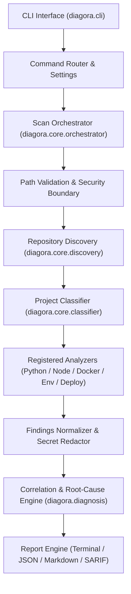

# Diagora Architecture Specification

## 1. Architectural Principles

Diagora is architected as a **modular monolith** following a **local-first, deterministic, read-only-by-default** execution model:

- **Deterministic Core**: All findings originate from explicit, testable rules backed by structured evidence (`observed` vs. `expected`).
- **Strict Separation of Static vs. Runtime Probes**: Static analyzers (`diagora.analyzers`) never spawn subprocesses or make network requests. Runtime checks (`diagora.runtime`) are isolated and require explicit opt-in (`--runtime`).
- **Typed Domain Models**: Every internal transfer object (`Finding`, `Evidence`, `DiagnosticIssue`, `ScanResult`, `RepositoryContext`, `RuleDefinition`) is validated via Pydantic v2 with a versioned output schema (`schema_version: "1.0.0"`).
- **Defense-in-Depth Security**: All file access flows through `diagora.core.security`, enforcing repository boundary containment, symlink escape protection, maximum file size/depth caps, and deterministic secret redaction.

---

## 2. Pipeline Data Flow

---

## 3. Package Responsibilities

| Package | Responsibility |
| ------- | -------------- |
| `diagora.core` | Domain models (`models.py`), exception hierarchy (`exceptions.py`), path/symlink/redaction security (`security.py`), repository discovery (`discovery.py`), project classification (`classifier.py`), analyzer registry (`registry.py`), scanner (`scanner.py`), and scan orchestration (`orchestrator.py`). |
| `diagora.rules` | Central rule registry (`registry.py`) and rule definitions catalog (`definitions/`) containing stable rule metadata (`PY001`–`PY010`, `ND001`–`ND010`, `ENV001`–`ENV006`, `DK001`–`DK010`, `DP001`–`DP003`). |
| `diagora.analyzers` | Base `Analyzer` protocol/abstract base class (`base.py`) and ecosystem-specific analyzer modules (`python`, `node`, `docker`, `environment`, `configuration`, `deployment`). |
| `diagora.diagnosis` | Finding normalization (`normalizer.py`), severity/confidence ordering (`severity.py`, `confidence.py`), and root-cause correlation interfaces (`correlator.py`, `root_cause.py`). |
| `diagora.runtime` | Controlled runtime probing interfaces (`environment_probe.py`, `process_runner.py`, `docker_probe.py`, `network_probe.py`) enforcing executable allowlists and timeouts. |
| `diagora.remediation` | Rule-based remediation planning (`planner.py`), patch preview (`patcher.py`), explicit approval (`approval.py`), and post-fix verification (`verifier.py`). |
| `diagora.reporting` | Versioned JSON serializer (`json.py`), Rich terminal renderer (`terminal.py`), Markdown renderer (`markdown.py`), and SARIF 2.1.0 adapter stub (`sarif.py`). |
| `diagora.integrations` | Optional adapters for AI root-cause explanation (`ai/`) and GitHub CI/SARIF workflows (`github/`). |
